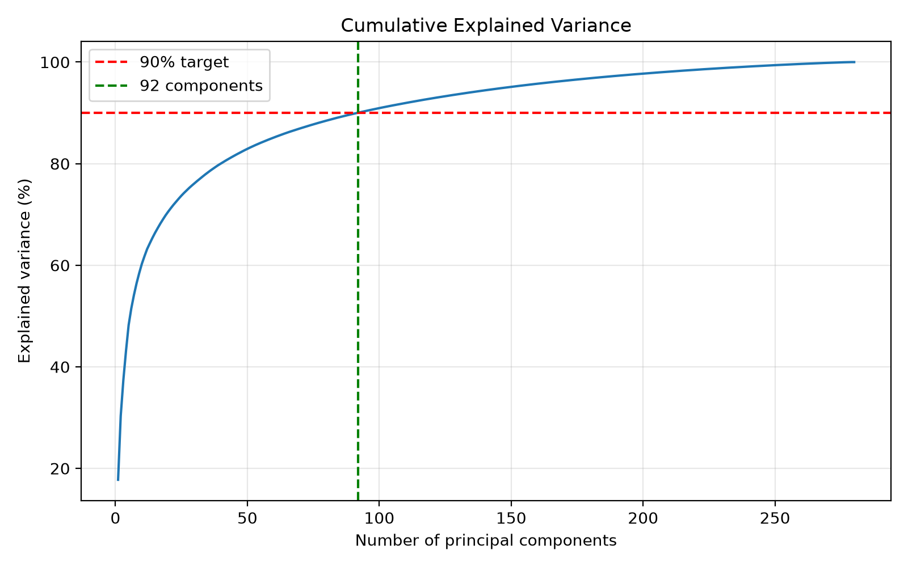
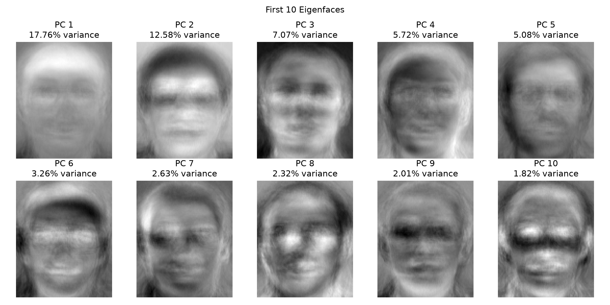
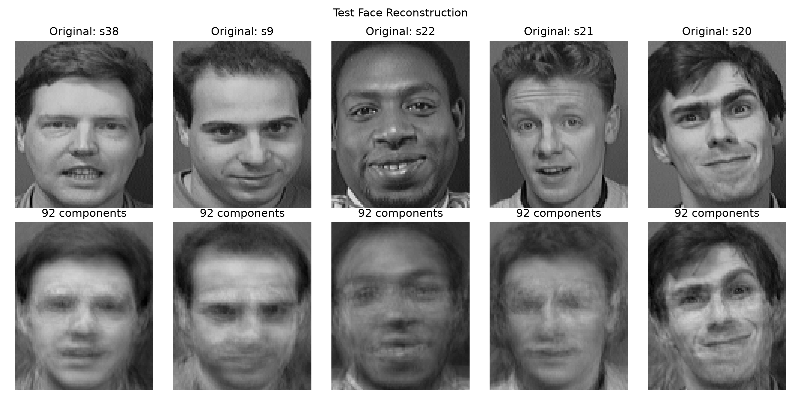
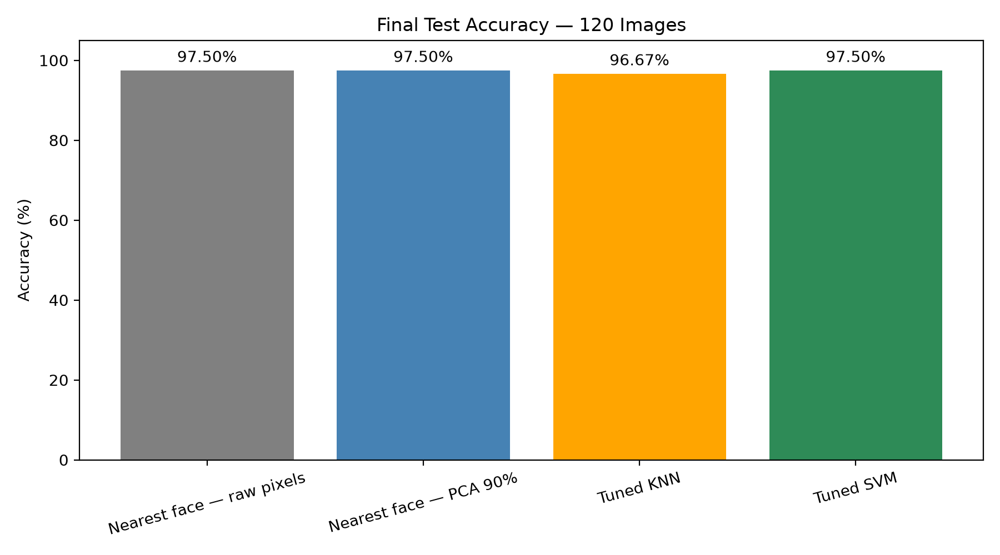

# DS605 Lab 7: PCA, Eigenfaces and Face Recognition

**Name:** Abhikarsh Raj  
**Roll Number:** 202618066  
**Course:** Fundamentals of Machine Learning (DS605)

## Objective

Represent face images numerically, implement Principal Component Analysis
(PCA) using NumPy, visualise eigenfaces, reconstruct images, and compare
face-recognition performance using nearest-face matching, KNN and SVM.

PCA is implemented using NumPy SVD and eigendecomposition.
Scikit-learn is used only for the traditional classifier comparison
and its evaluation.

## Dataset

The ORL / AT&T Database of Faces contains:

- 400 grayscale images.
- 40 subjects, with 10 images per subject.
- Image dimensions: 112 rows × 92 columns.
- PGM image format.
- Subject folders named `s1` through `s40`.

Each folder represents one subject. Different images within the same
folder share the same subject label.

This is a closed-set recognition task: all test subjects are represented
in the training set.

## Project Files

Keep the notebook and README in the project root.

| Path | Description |
|---|---|
| `README.md` | Project documentation |
| `01_data_checking_eda.ipynb` | Complete notebook; replace this name if your notebook differs |
| `Data/` | Extracted dataset containing subject folders |
| `outputs/pca_representation.npz` | PCA coordinates, basis, mean, labels and split information |
| `outputs/image_metadata.csv` | Image properties and brightness statistics |
| `outputs/model_comparison.csv` | Final test results |
| `outputs/knn_validation_results.csv` | KNN tuning results |
| `outputs/svm_validation_results.csv` | SVM tuning results |
| `outputs/fitting_validation_diagnostics.csv` | Fitting and validation comparisons |
| `outputs/svm_classification_report.csv` | Per-subject evaluation metrics |
| `outputs/svm_errors.csv` | Incorrect SVM predictions |
| `outputs/storage_comparison.csv` | Storage comparison |
| `outputs/figures/` | Saved plots |

## Installation and Execution

### 1. Install dependencies

Use Python 3.9 or newer.

```bash
python -m pip install numpy pandas pillow matplotlib scikit-learn notebook
```

### 2. Prepare the dataset

Obtain the ORL / AT&T face dataset specified in the lab brief.

Extract the subject folders into `Data`, so an image can be found at:

```text
Data/s1/1.pgm
```

Preserve the original dataset README and attribution.

### 3. Use a portable dataset path

Place the notebook in the project root and use:

```python
from pathlib import Path

DATA_DIR = Path("Data")
```

Replace any machine-specific absolute path with this relative path.

### 4. Run the notebook

Start Jupyter from the project root:

```bash
jupyter notebook
```

Open the notebook, restart the kernel, and run all cells in order.
Run the saving cells and save the notebook with its outputs.

The reported results below are from the recorded notebook run.
Verify a fresh-kernel run before submission.

## 1. Data Checking and EDA

| Check | Result |
|---|---:|
| Images loaded | 400 |
| Subjects | 40 |
| Images per subject | 10 |
| Image dimensions | 112 × 92 |
| Colour mode | Grayscale |
| Original datatype | uint8 |
| Observed pixel range | 0–251 |
| Unreadable images | 0 |
| Exact duplicate groups | 0 |
| Constant-intensity images | 0 |

The dataset is balanced and all images have consistent dimensions,
so resizing and class balancing were unnecessary.

EDA included:

- Image counts per subject.
- Multiple images of the same subject.
- Exact duplicate checks.
- Constant-intensity checks.
- Average image brightness distribution.

### Brightness statistics

| Statistic | Value |
|---|---:|
| Mean image brightness | 112.63 |
| Standard deviation of image-average brightness | 13.80 |
| Minimum image-average brightness | 76.84 |
| Median image-average brightness | 113.07 |
| Maximum image-average brightness | 147.99 |

These statistics describe averages across images, not the distribution
of individual pixel values.

## 2. Image Representation

Each image is flattened into a feature vector:

```text
112 × 92 = 10,304 features per image
```

The resulting arrays are:

```text
X.shape = (400, 10304)
y.shape = (400,)
```

Pixel values are converted to `float64` for PCA calculations.

## 3. Train–Test Split

A reproducible split is created using NumPy with random seed `42`.

| Set | Images per subject | Total images |
|---|---:|---:|
| Training | 7 | 280 |
| Testing | 3 | 120 |

Every subject appears in both sets, and no image index appears in both.

Subjects and image filenames are sorted numerically before splitting.

## 4. Mean Centering

The mean face is calculated using training images only.

```python
mean_face = X_train.mean(axis=0)

X_train_centered = X_train - mean_face
X_test_centered = X_test - mean_face
```

Using the training mean for both sets prevents test information
from entering PCA fitting.

The largest absolute centered training-feature mean was approximately
`3.54e-14`, effectively zero within floating-point precision.

## 5. PCA Using NumPy SVD

Reduced SVD is applied to the centered training matrix:

```python
U, singular_values, Vt = np.linalg.svd(
    X_train_centered,
    full_matrices=False
)
```

Rows of `Vt` represent principal directions.

Covariance eigenvalues are obtained from:

```python
explained_variance = (
    singular_values ** 2 / (X_train_centered.shape[0] - 1)
)
```

The first five components explain approximately:

```text
17.76%, 12.58%, 7.07%, 5.72%, 5.08%
```

### Selecting components

| Components | Cumulative training variance |
|---|---:|
| 91 | 89.92% |
| 92 | 90.04% |

Therefore, **92 components** are the minimum needed to preserve
at least 90% of training variance.

Variance retention is not the same as recognition accuracy.

## 6. PCA Using Eigendecomposition

A smaller Gram matrix is used instead of explicitly constructing
the full feature covariance matrix:

```python
gram_matrix = (
    X_train_centered @ X_train_centered.T
) / (X_train_centered.shape[0] - 1)
```

Its shape is `(280, 280)`, compared with `(10304, 10304)`
for the feature covariance matrix.

The Gram eigenvectors associated with positive eigenvalues are
mapped back into pixel space and compared with the SVD basis.

| Comparison | Result |
|---|---:|
| Relative eigenvalue error | 1.231e-15 |
| Smallest principal-angle cosine | 1.000000000000 |

Both approaches recover equivalent retained PCA subspaces.

Eigenvector signs may differ without changing the PCA solution.

## 7. Eigenfaces and Projection

The first ten principal directions are reshaped into images
to visualise eigenfaces.

Eigenfaces represent patterns of variation rather than individual people.

Projection uses:

```python
W = Vt[:92].T

Z_train = X_train_centered @ W
Z_test = X_test_centered @ W
```

The reduced shapes are:

```text
Training: (280, 92)
Testing:  (120, 92)
```

## 8. Image Reconstruction

Images are reconstructed using:

```python
X_reconstructed = Z @ W.T + mean_face
```

| Dataset | Reconstruction MSE |
|---|---:|
| Training | 154.43 |
| Testing | 335.52 |

MSE is calculated using unclipped floating-point reconstructions
in the original pixel scale. Values are clipped only for display.

Lower training reconstruction error is expected because PCA
was fitted on training images. This difference alone does not
establish overfitting.

## 9. Storage Comparison

| Representation | Size (MiB) |
|---|---:|
| Original pixels: uint8 | 3.931 |
| Original pixels: float64 | 31.445 |
| PCA coordinates only: float64 | 0.281 |
| PCA basis and mean: float64 | 7.311 |
| Complete PCA representation: float64 | 7.592 |

Including the basis and mean, PCA uses:

- **75.86% less memory** than the float64 pixel representation.
- **1.93 times the memory** of the original uint8 pixels.

Feature reduction does not automatically imply lower total storage.
The basis must also be stored, and float64 uses more bytes than uint8.

These measurements describe array payloads, excluding labels and
file-format overhead. Compressed NPZ file size is a separate measurement.

## 10. Nearest-Face Recognition

For each test image, the closest training image is found using
Euclidean distance. Its subject label becomes the prediction.

This is equivalent to 1-nearest-neighbour classification.

| Representation | Correct predictions | Test accuracy |
|---|---:|---:|
| Raw pixels | 117/120 | 97.50% |
| 92 PCA features | 117/120 | 97.50% |

The two methods disagree on two test-image predictions despite
having the same overall accuracy.

Correct and incorrect PCA matches are displayed in the notebook.

## 11. KNN and SVM Validation

The 280-image training set is divided again using seed `123`.

| Subset | Images per subject | Total |
|---|---:|---:|
| Fitting | 5 | 200 |
| Validation | 2 | 80 |

A separate mean and PCA are fitted using only the 200 fitting images.
Validation images are transformed using those fitting-only parameters.

This PCA requires **75 components** to retain 90% variance.

### KNN search

- PCA components: 25, 50, 75, 100, 150.
- Neighbours: 1, 3, 5, 7.
- Weights: uniform and distance.
- Metric: Euclidean.

### SVM search

- PCA components: 25, 50, 75, 100, 150.
- Kernels: linear and RBF.
- C: 0.01, 0.1, 1, 10, 100.
- RBF gamma: `scale`, 0.001, 0.01.

SVM inputs are PCA scores divided by 255.
The same fixed scaling is used during validation and final evaluation.

### Selected settings

| Model | Components | Settings | Validation accuracy |
|---|---:|---|---:|
| KNN | 25 | k=1, uniform | 92.50% |
| SVM | 50 | Linear, C=0.1 | 96.25% |

Gamma has no effect on the linear kernel.

Ties favour fewer components. KNN then favours fewer neighbours
and uniform weights; SVM favours a linear kernel and smaller C.

The tuned component counts are recognition experiments separate
from the 92-component, 90%-variance baseline.

After selection, both classifiers are refitted on all 280 training
images using the full-training PCA basis.

## 12. Underfitting and Overfitting Analysis

| Configuration | Fitting accuracy | Validation accuracy | Gap |
|---|---:|---:|---:|
| KNN: 25 PCs, k=1 | 100.00% | 92.50% | 7.50 points |
| KNN: 25 PCs, k=7, uniform | 85.00% | 80.00% | 5.00 points |
| SVM: 50 PCs, linear, C=0.1 | 100.00% | 96.25% | 3.75 points |
| SVM: 50 PCs, RBF, C=0.01, gamma=0.001 | 97.50% | 81.25% | 16.25 points |

### Observations

- Uniform KNN with k=7 shows possible underfitting from excessive
  smoothing. Only five fitting images exist per subject.
- A 100% fitting score is expected for 1-NN because each training
  image matches itself.
- Distance-weighted KNN also gives optimistic fitting scores
  through zero-distance self-matches.
- Some RBF settings show a substantial generalisation gap.
- The selected linear SVM has strong validation performance
  and a relatively small gap.

These are single-split diagnostics, not proof that overfitting
is absent. One validation prediction changes accuracy by 1.25
percentage points, and selecting among many settings can make
the best validation score optimistic.

## 13. Final Test Results

| Method | Features | Correct predictions | Test accuracy |
|---|---:|---:|---:|
| Nearest face: raw pixels | 10,304 | 117/120 | 97.50% |
| Nearest face: PCA 90% | 92 | 117/120 | 97.50% |
| Tuned KNN | 25 | 116/120 | 96.67% |
| Tuned SVM | 50 | 117/120 | 97.50% |

The 50-component SVM matches the raw-pixel baseline with far
fewer features. Tuned KNN makes one additional test error.

This small difference on one split does not establish general
superiority. No runtime speedup was measured.

Baseline test results were inspected before classifier tuning,
but hyperparameter selection used the internal validation set.
Final test results were not used for further tuning.

## 14. SVM Error Analysis

| Image | True subject | Predicted subject |
|---|---|---|
| `s26/7.pgm` | s26 | s28 |
| `s32/7.pgm` | s32 | s2 |
| `s5/10.pgm` | s5 | s18 |

All three images remain in the evaluation. No failures were
removed and no labels were changed.

Each affected subject has 66.67% recall because there are three
test images per subject. The remaining 37 subjects have 100% recall.

The notebook compares these images with training examples of
the true and predicted subjects. These are visual references,
not explanations of the SVM decision mechanism.

These errors should not be assumed to be the same images
misclassified by PCA nearest-face matching.

## Figures

Run the figure-saving cell and commit the generated files
so these relative image links display correctly.

### Explained variance



### Eigenfaces



### Reconstruction



### Model comparison



## Conclusions

- NumPy SVD and eigendecomposition produce equivalent retained
  PCA subspaces.
- 92 components preserve 90.04% of training variance.
- PCA nearest-face matching achieves 97.50% test accuracy.
- A validation-selected linear SVM achieves the same test
  accuracy using 50 components.
- Reconstruction loses detail, and total storage depends on
  datatype and basis overhead.
- Errors are retained and analysed rather than manually corrected.

## Limitations and Future Work

The dataset is small and controlled, with only three test images
per subject. Results do not establish performance for arbitrary
lighting, pose, occlusion or previously unseen identities.

Possible extensions include repeated stratified validation,
lighting normalisation and alternative distance measures.

Further model changes should be selected using training and
validation data. A fresh untouched test set is needed for a
new final performance claim after test-informed development.

## Dataset Acknowledgement

Credit to **Olivetti Research Laboratory**, Cambridge, UK,
for the ORL face database, as requested in the dataset README.

Reference supplied with the dataset:

F. Samaria and A. Harter, “Parameterisation of a stochastic model
for human face identification,” 2nd IEEE Workshop on Applications
of Computer Vision, December 1994, Sarasota, Florida.

## Submission

Submit the **public GitHub repository link**.

Include the runnable notebook, result tables, figures and this
README. Verify a fresh-kernel run and ensure the dataset setup
instructions are sufficient to reproduce the project.